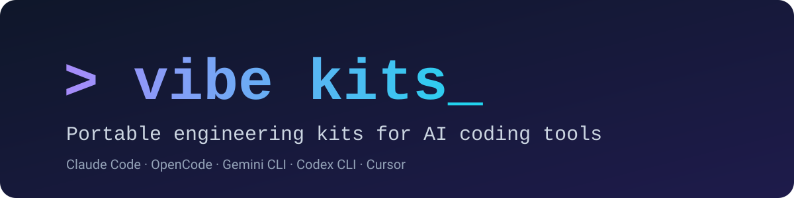

<p align="center">
  
</p>

<p align="center">
  <b>Give every AI coding agent you use the same senior-engineer brain, with one install command per tool.</b>
</p>

<p align="center">
  <a href="https://pypi.org/project/vibe-kits/"></a>
  <a href="https://github.com/kidboy-man/vibe-engineering/actions/workflows/python-package.yml"></a>
  
  <a href="https://github.com/kidboy-man/vibe-engineering/blob/main/LICENSE"></a>
</p>

<p align="center">
  <a href="#quickstart">Quickstart</a> ·
  <a href="#supported-tools">Supported tools</a> ·
  <a href="#the-kits">Kits</a> ·
  <a href="#safe-by-design">Safety</a> ·
  <a href="https://github.com/kidboy-man/vibe-engineering/tree/main/docs/kits">Docs</a>
</p>

---

## Why vibe-kits?

You use Claude Code, Cursor, Codex, Gemini and OpenCode, and every one of them
starts with a blank config. Your rules, review habits and safety limits get
copied by hand and slowly drift apart.

`vibe kits` installs one portable engineering setup into each tool's native
format: a persona, modular rules, review agents, slash commands, guardrail
hooks and a local second-brain. Every install can be previewed with
`--dry-run`, is tracked in a manifest, never copies secrets, and never
overwrites your own config keys.

- The same rules ship as `CLAUDE.md`, `AGENTS.md`, `GEMINI.md` or Cursor `.mdc` files.
- Hooks in Claude Code, Codex and Cursor stop `rm -rf ~`, force-pushes and `.env` reads before the agent runs them. They are heuristics; obfuscated commands can get past them.
- A PRD → TRD → tickets → TDD workflow comes with a traceability checker.
- A local Obsidian + qmd vault gives your agents notes they can search.

## Quickstart

Needs Python 3.10+. Install with [pipx](https://pipx.pypa.io) (recommended) or
`pip install vibe-kits`.

```bash
pipx install vibe-kits

vibe kits list                              # see every kit
vibe kits claude-code install --dry-run     # preview: writes nothing
vibe kits claude-code install --yes         # install
vibe kits claude-code doctor                # health check

vibe upgrade                                # self-upgrade later
```

Swap `claude-code` for `opencode`, `gemini`, `codex` or `cursor`. Every kit has
the same verbs: `doctor`, `install [--dry-run]`, `diff` and `uninstall`.

## See it run

Real output of `vibe kits claude-code install --dry-run`:

```text
$ vibe kits claude-code install --dry-run
create CLAUDE.md
create rules/database-and-operations.md
create rules/go-backend-engineering.md
create rules/operating-model.md
create rules/security-and-data-safety.md
create rules/testing-and-verification.md
create rules/uncertainty-and-sources.md
create agents/backend-tech-lead.md
create agents/db-operations-reviewer.md
create agents/go-backend-implementer.md
create agents/security-data-reviewer.md
create agents/tdd-test-engineer.md
create commands/clone-setup.md
create commands/review-go.md
create commands/trd.md
create skills/vibe-engineering/SKILL.md
merge settings.json safe fragment
write .vibe-engineering-manifest.json
dry run: no files written
```

<!-- Demo GIF: record with `vhs docs/assets/demo.tape`, then uncomment.
<p align="center"></p>
-->

## Supported tools

Each of Claude Code, OpenCode, Gemini CLI, Codex CLI and Cursor has its own
setup kit, named `claude-code`, `opencode`, `gemini`, `codex` and `cursor`.
Four more kits work across tools (Gemini CLI uses only its own setup kit):

| Kit | Claude Code | OpenCode | Codex CLI | Cursor |
|-----|:-----------:|:--------:|:---------:|:------:|
| [`workflow`](https://github.com/kidboy-man/vibe-engineering/blob/main/docs/kits/workflow.md) | ✅ | ✅ | | |
| [`guardrails`](https://github.com/kidboy-man/vibe-engineering/blob/main/docs/kits/guardrails.md) | ✅ | | ✅ | ✅ |
| [`wikify`](https://github.com/kidboy-man/vibe-engineering/blob/main/docs/kits/wikify.md) | ✅ | | ✅ | ✅ |
| [`second-brain`](https://github.com/kidboy-man/vibe-engineering/blob/main/docs/kits/second-brain.md) | ✅ | ✅ | ✅ | ✅ |

`workflow`, `guardrails` and `wikify` install only into agent config directories
that already exist. `second-brain` creates the config files it merges into,
including their directories.

## The kits

### Agent setup

**`claude-code`**: Senior/staff backend persona, six modular rules, five
review/implementation agents, slash commands and skills in `~/.claude`.
[Full docs →](https://github.com/kidboy-man/vibe-engineering/blob/main/docs/kits/claude-code.md)

**`opencode`**: The same content in OpenCode's layout. `AGENTS.md` is merged
between markers, never overwritten, and safe defaults are added to `opencode.jsonc`
without overwriting your keys.
[Full docs →](https://github.com/kidboy-man/vibe-engineering/blob/main/docs/kits/opencode.md)

**`gemini`** / **`codex`**: One self-contained `GEMINI.md` / `AGENTS.md` with
the persona, all rules and specialist roles embedded.
[Gemini →](https://github.com/kidboy-man/vibe-engineering/blob/main/docs/kits/gemini.md) ·
[Codex →](https://github.com/kidboy-man/vibe-engineering/blob/main/docs/kits/codex.md)

**`cursor`**: Seven `.mdc` rule files with frontmatter, so Go, test and DB
rules load only for matching files.
[Full docs →](https://github.com/kidboy-man/vibe-engineering/blob/main/docs/kits/cursor.md)

### Workflow and safety

**`workflow`**: Business requirement → PRD → TRD → tickets → TDD, through
`/prd`, `/flow`, `/implement-ticket` and `/push-tickets`. A standard-library
validator catches duplicate IDs, dependency cycles and Must requirements that
have no ticket.
[Full docs →](https://github.com/kidboy-man/vibe-engineering/blob/main/docs/kits/workflow.md)

**`guardrails`**: Pre-tool-use hooks that deny catastrophic `rm -rf`, force
pushes, `git reset --hard`, shell `DROP`/`TRUNCATE`, and reads of `.env*`, keys
and cloud credentials. Opt-in `--with-verify` adds gofmt checks on Go edits.
[Full docs →](https://github.com/kidboy-man/vibe-engineering/blob/main/docs/kits/guardrails.md)

**`wikify`**: A cited `docs/wiki` that agents load through a small map. A
push gate blocks `git push` while the wiki has drifted from the code, and
`vibe wikify adopt` folds existing docs into the wiki.
[Full docs →](https://github.com/kidboy-man/vibe-engineering/blob/main/docs/kits/wikify.md)

### Knowledge

**`second-brain`**: Scaffolds a local-first Obsidian + qmd vault and wires a
`qmd` MCP entry into your agents, so they can search what you already learned.
[Full docs →](https://github.com/kidboy-man/vibe-engineering/blob/main/docs/kits/second-brain.md) ·
[Setup guide →](https://github.com/kidboy-man/vibe-engineering/blob/main/docs/wiki/guides/second-brain-setup.md)

```bash
vibe kits second-brain install --dry-run --yes
VIBE_SECOND_BRAIN_PATH="$HOME/notes" vibe kits second-brain install --yes
```

## Safe by design

- **No secrets.** Auth tokens, API keys, proxy URLs and model or provider choices are never copied or overwritten.
- **Preview first.** `--dry-run` and `diff` show every change; changed files are backed up first.
- **Manifest uninstall.** `uninstall` removes only what the kit installed.
- **User data kept.** Your own config keys and the second-brain vault are never deleted.
- **Network only on request.** No kit install touches the network, with one exception: `second-brain` can run `npm install -g @tobilu/qmd`, and only with `--setup-deps` plus your confirmation. (`vibe upgrade` upgrades the CLI itself only when you run it.)

Full contract: [Safety model →](https://github.com/kidboy-man/vibe-engineering/blob/main/docs/kits/safety-model.md)

## Help and community

- **Bugs and ideas:** [open an issue](https://github.com/kidboy-man/vibe-engineering/issues/new/choose).
- **Security reports:** see [SECURITY.md](https://github.com/kidboy-man/vibe-engineering/blob/main/SECURITY.md). Please don't file them as public issues.
- **Contributing:** [CONTRIBUTING.md](https://github.com/kidboy-man/vibe-engineering/blob/main/CONTRIBUTING.md) covers dev setup, tests and how to add a kit.
- **Conduct:** [Code of Conduct](https://github.com/kidboy-man/vibe-engineering/blob/main/CODE_OF_CONDUCT.md).

## License

[MIT](https://github.com/kidboy-man/vibe-engineering/blob/main/LICENSE) · [Releases and changelog](https://github.com/kidboy-man/vibe-engineering/releases)
